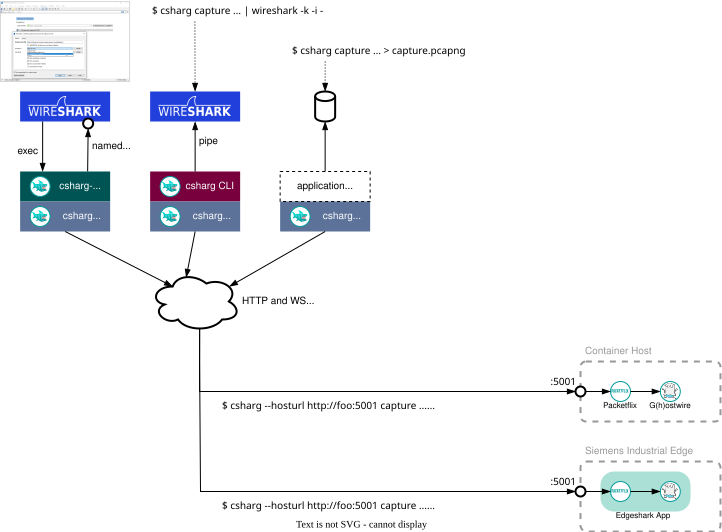

[](https://github.com/siemens)
[](https://github.com/industrial-edge)
[](https://github.com/siemens/edgeshark)

# csharg

[](https://pkg.go.dev/github.com/siemens/csharg/v2)
[](https://img.shields.io/github/license/siemens/csharg)


`csharg/v2` is a Golang module for easy CLI access to the
[Packetflix](https://github.com/siemens/packetflix) capture service deployed to
container hosts, such as [Edgeshark](https://github.com/siemens/edgeshark) on
[Siemens Industrial Edge](https://github.com/industrial-edge) and also
standalone Docker hosts.

`csharg/v2` is part of the "Edgeshark" project that consist of several
repositories:
- [Edgeshark Hub repository](https://github.com/siemens/edgeshark)
- [G(h)ostwire discovery service](https://github.com/siemens/ghostwire)
- [Packetflix packet streaming service](https://github.com/siemens/packetflix)
- [Containershark Extcap plugin for
  Wireshark](https://github.com/siemens/cshargextcap)
- support modules:
  - 🖝 **csharg (CLI)** 🖜
  - [mobydig](https://github.com/siemens/mobydig)
  - [ieddata](https://github.com/siemens/ieddata)

## Usage

`csharg/v2` can be used in different ways:

- as the standalone CLI program `csharg`, such as in:

  ```bash
  csharg --host localhost:5001 capture mycontainer | wireshark -k -i -
  ```

  For details, see further down below.

- via the [Containershark Extcap plugin for
  Wireshark](https://github.com/siemens/cshargextcap) with a nice Wireshark UI.

- and finally, directly in your own applications and (micro) services by
  integrating the `csharg` module without having to care about details of the
  Packetflix capture service API.



key:
- `$ csharg ...` denotes a CLI command.
- `csharg.New...()` denotes a `csharg` package constructor for connecting to the
  capture service of container hosts.

## Build

To build `csharg` binary distribution packages for serveral Linux architectures,
as well as for Windows (only amd64):

```bash
make dist
```

Afterwards, the `dist/` directory contains the built packages and archives.
Supported CPU architectures:
- amd64
- arm64

The following package formats are currently supported:
- `.apk`
- `.deb`
- `.rpm`
- `.tar.gz`

## `csharg` CLI

### Commands

This section doesn't aim to be a comprehensive documentation of the `csharg`CLI,
but will give you an idea as to what you might be able to do with the `csharg`
CLI. If in doubt, please use `csharg help` for up-to-date documentation.

- `csharg list`: list available capture targets on a container host.
- `csharg capture`: capture and live stream network traffic from a capture
  target, such as a pod, standalone container, et cetera.
- `csharg help`: ask for help about any of the `csharg` commands.
- `csharg options`: list the global command-line options which apply to all commands.
- `csharg version`: show csharg version.

The CLI `--host [http://|https://]$HOSTNAME[:$PORT][/$PATH]` argument specifies
hostname (DNS/label or IP address) and optional port number of the Packetflix
service on a container host; the scheme defaults to `http://`. Standard
deployments use port `:5001`. Please note that the port always needs to be
specified, unless it is port `:80` (or `:443` for HTTPS).

To list available capture targets in your container host or local KinD
deployment:

- list only stand-alone containers, which are not inside pods: `csharg --host
  ... list containers`. Please note that due to the Kubernetes sandbox model
  with shared network stacks csharg doesn't show or handle the containers
  _inside_ pods, but only containers that do _not_ belong to any pod.
- list network stacks which neither belong to pods nor stand-alone containers:
  `csharg --host ... list networks` (includes bind-mount'ed network stacks).
- list only pods: `csharg --host ... list pods` (KinD).
- list all capture targets (and we really mean *all*): `csharg --host ... list`.

### Controlling Capture Target List Output

`csharg` will list capture targets in tabular format, unless another output
format is specified. For example:

```
$ csharg --host localhost:5001 list
TARGET                                                       TYPE         NODE
accounts-daemon(997)                                         proc         localhost
chrome(79357)                                                proc         localhost
default/nginx                                                pod          localhost
gostwire-gostwire-1                                          docker       localhost
haveged(984)                                                 proc         localhost
kind-control-plane                                           docker       localhost
kube-system/coredns-787d4945fb-787ms                         pod          localhost
kube-system/coredns-787d4945fb-s6drr                         pod          localhost
kube-system/etcd-kind-control-plane                          pod          localhost
kube-system/kindnet-zhgf2                                    pod          localhost
kube-system/kube-apiserver-kind-control-plane                pod          localhost
kube-system/kube-controller-manager-kind-control-plane       pod          localhost
kube-system/kube-proxy-hgbpl                                 pod          localhost
kube-system/kube-scheduler-kind-control-plane                pod          localhost
local-path-storage/local-path-provisioner-75f5b54ffd-xrzg8   pod          localhost
packetflix-packetflix-1                                      docker       localhost
rtkit-daemon(1528)                                           proc         localhost
systemd(1)                                                   proc         localhost
```

The following output formatting options are available (see also `csharg
help list`):

- `-o wide`: wide tabular multi-column format.
- `-o json`: list capture target details in JSON format.
- `-o jsonpath=${JSONPATH-EXPRESSION}`: print fields defined in the [JSONPath
  expression](https://kubernetes.io/docs/reference/kubectl/jsonpath/).
- `-o jsonpath-file=$FILENAME`: print fields defined in the [JSONPath
  expression](https://kubernetes.io/docs/reference/kubectl/jsonpath/) from file
  *filename*.
- `-o yaml`: lots of ugly YAML data for the available capture targets.
- `-o custom-columns=$SPEC`, where `$SPEC` is a `kubectl`-like [custom columns
  specification](https://kubernetes.io/docs/reference/kubectl/overview/#custom-columns). For instance: `-o custom-columns=NAME:.Name,NODE:.NodeName`.
- `-o custom-columns-file=$FILENAME`: use the [custom
  columns](https://kubernetes.io/docs/reference/kubectl/overview/#custom-columns)
  format from file *filename*.
- `-o name`: simply lists only target names, but no other details.

Please note that `--no-headers` can be used with the standard format, as well as
`-o wide`, `-o custom-columns=...`, and `-o custom-columns-file=...` to hide the
column headers.

### Capture Live Network Traffic

In the most simple case, just specify a unique capture target name (such as a
container name) and then `csharg` will stream the captured network traffic to
stdout in pcapng format:

```sh
csharg --host localhost:5001 capture container-name
```

Pods need to be specified using the *podnamespace*/*podname* notation, with
*podnamespace* being **mandatory**, unless using `csharg capture pod`, which
defaults to the "default" namespace.

Use option `-w `*`filename`* to write the packet capture stream into the file
*filename*. As it is custom, `-w -` again writes to stdout (which is the default
anyway).

Probably more typical is to feed the live stream directly into Wireshark, this
works _without_ having to install the [Containershark extcap
plugin](https://github.com/siemens/cshargextcap):

```sh
csharg --host localhost:5001 capture special/mypod | wireshark -k -i -
```

The capture will run until you terminate/interrupt `csharg` with SIGINT or
SIGTERM, for instance, by pressing ^C in your terminal session where you started
`csharg` in the foreground.

By default, captures will capture from all network interfaces of the specified
target. Use one or multiple `-i`/`--interface` options to specify only those
network interfaces you want to capture from:

```bash
csharg --host ... capture container container-name -i lo
```

Filter captures at the source using the `--filter` option -- the [capture filter
syntax](https://wiki.wireshark.org/CaptureFilters) is Wireshark's
[dumpcap](https://www.wireshark.org/docs/man-pages/dumpcap.html) filter syntax.

> **Standalone Host:** as long as the target name is unique, `csharg capture`
> will start a capture even without having to specify the node/host. This makes
> capturing from a standalone container host especially convenient when using
> `csharg capture ...` instead of `csharg capture container ...`.

## Look Mum, My First Csharg Program!

Capture five minutes of network traffic on all network interfaces of container
`"my-container"` and write the captured packets into a file named
`"my-container.pcapng"`.

```go
package main

import (
    "log"
    "os"
    "time"

    "github.com/siemens/csharg/v2"
)

func main() {
    // Connect to the host-local Packetflix capture service. Default settings
    // and service time limits (30s) apply. Sensibly, capture streaming is
    // not time limited.
    st, err := csharg.NewSharkTankOnHost("http://localhost:5001", nil)
    if err != nil {
        log.Fatal(err)
    }
    // Create a new packet capture file...
    f, err := os.Create("my-container.pcapng")
    if err != nil {
        log.Fatal(err)
    }
    defer f.Close()
    // ...and run a network packet capture for five minutes on the container
    // "my-container". On a standalone host, the node name is the host name
    // of the capture service URL.
    capt, err := st.CaptureContainer(f, "localhost", "my-container", nil)
    if err != nil {
        log.Fatal(err)
    }
    if err := capt.StopAfter(5 * time.Minute); err != nil {
        log.Fatal(err)
    }
}
```

## FAQ

- **What does "csharg" mean?**

  "csharg" is short for "Container Shark" or "Containershark".

- **Shouldn't this be "cshark"?**

  Not necessarily, as this is a _[Go](https://go.dev/)_ package.

## Make Targets

- `make`: lists all targets.
- `make clean`: removes the build artefacts.
- `make dist`: builds snapshot packages and archives of the csharg CLI binary.
- `make e2e`: runs the opt-in end-to-end tests.

## End-to-End Tests

The end-to-end tests in `e2e/` run csharg against a real Packetflix capture
service and thus are opt-in: plain `go test ./...` skips them. Run them by
selecting the `e2e` Ginkgo label, or simply using `make e2e`:

```bash
go test -v -race -p 1 ./e2e/... -ginkgo.label-filter=e2e
```

Further labels narrow the selection, for instance `-ginkgo.label-filter='e2e &&
!k8s'`. Label filters that don't explicitly select `e2e`, such as `'!k8s'`,
still skip the end-to-end tests.

The end-to-end tests require a local Docker engine that allows containers
sharing the host's PID namespace with additional capabilities, as well as
`tshark` and `capinfos` (already baked into the devcontainer). They deploy the `ghcr.io/siemens/ghostwire` and
`ghcr.io/siemens/packetflix` services together with `busybox` capture targets,
and then automatically clean up afterwards.

# Contributing

Please see [CONTRIBUTING.md](CONTRIBUTING.md).

## License and Copyright

(c) Siemens AG 2023, 2026

[SPDX-License-Identifier: MIT](LICENSE)
